# Theseus

A native and feature-complete iPhone and iPad app for [Open WebUI](https://github.com/open-webui/open-webui). Connect it to your server, sign in, and chat with the models that server offers.

[Website](https://unru.sh/theseus/) · [Privacy](https://unru.sh/theseus/privacy/) ·
[Support](https://unru.sh/theseus/support/)

<a href="media/theseus-launch.mp4">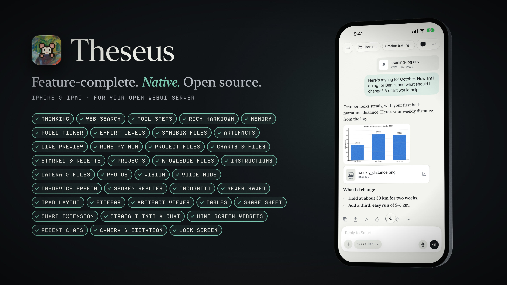</a>

[Watch the launch video](media/theseus-launch.mp4) (96 s) · [Short version](media/theseus-social.mp4) (20 s)

## What it does

Theseus is written in Swift for iPhone and iPad and talks to your server's own API, so chats, Projects and Memory
are the same as in the Open WebUI web app.

### Chat

<table>
<tr>
<td align="center" valign="top">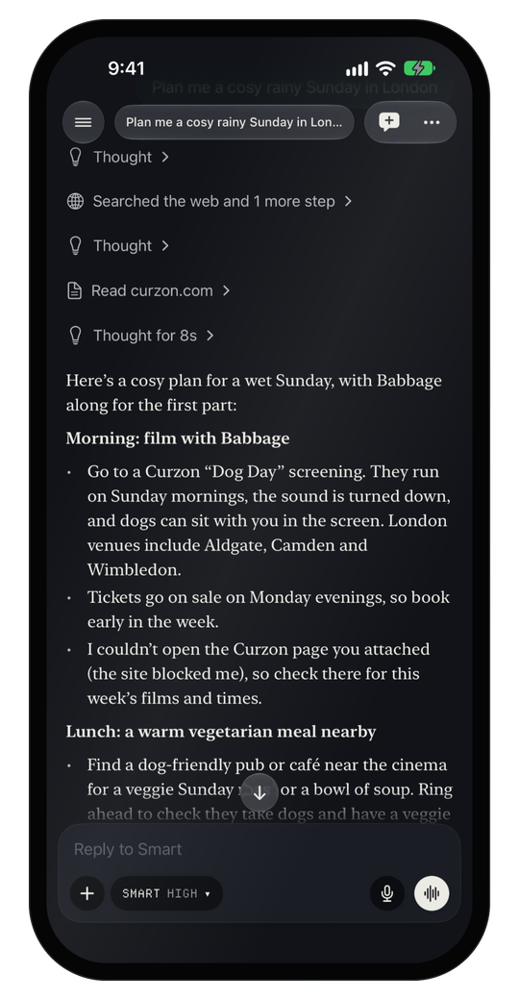<br><b>Every step in the answer</b><br>Thinking, web searches and sources, streamed as the model writes.</td>
<td align="center" valign="top">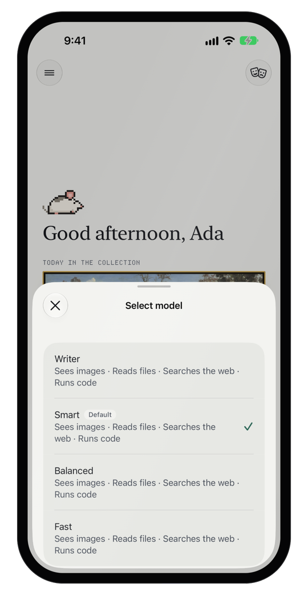<br><b>Every model on your server</b><br>Pick a model per chat and how much effort it spends.</td>
<td align="center" valign="top">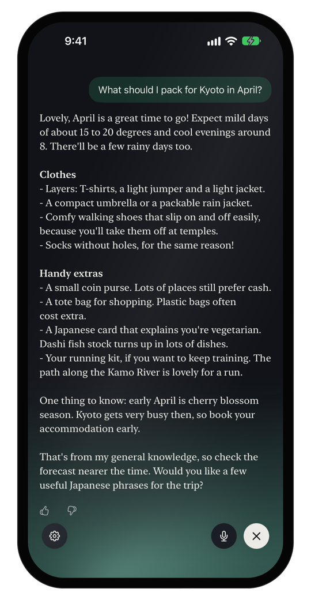<br><b>Voice mode</b><br>Talk hands-free; speech stays on the device by default.</td>
</tr>
</table>

Answers stream in with Markdown, code blocks, math and tables. When a model thinks, searches the web or calls a tool,
each step appears in the answer and can be opened; sources are listed underneath. You can edit a message, retry a
response, move between branches, copy, share, and rate or report an answer. Dictate into the composer, or switch to
voice mode: it listens, answers aloud and keeps the conversation as text.

### Files, Artifacts and code

<table>
<tr>
<td align="center" valign="top">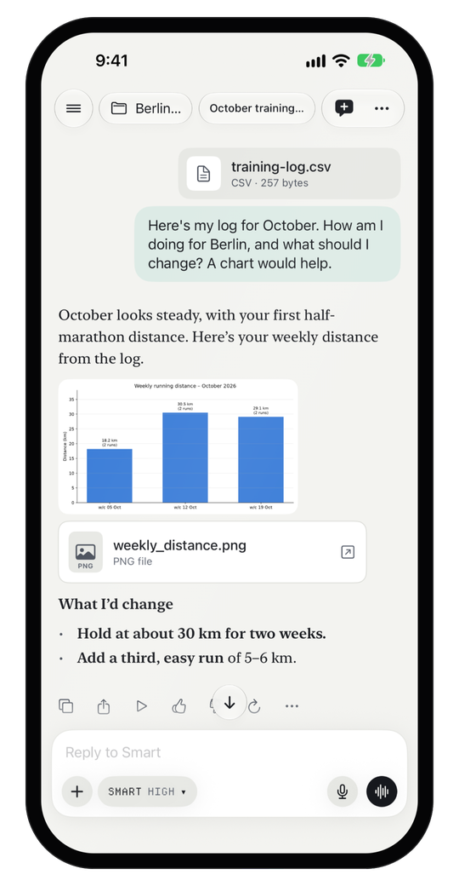<br><b>Charts and files in the chat</b><br>Models run code in your server's sandbox and hand back what they made.</td>
<td align="center" valign="top">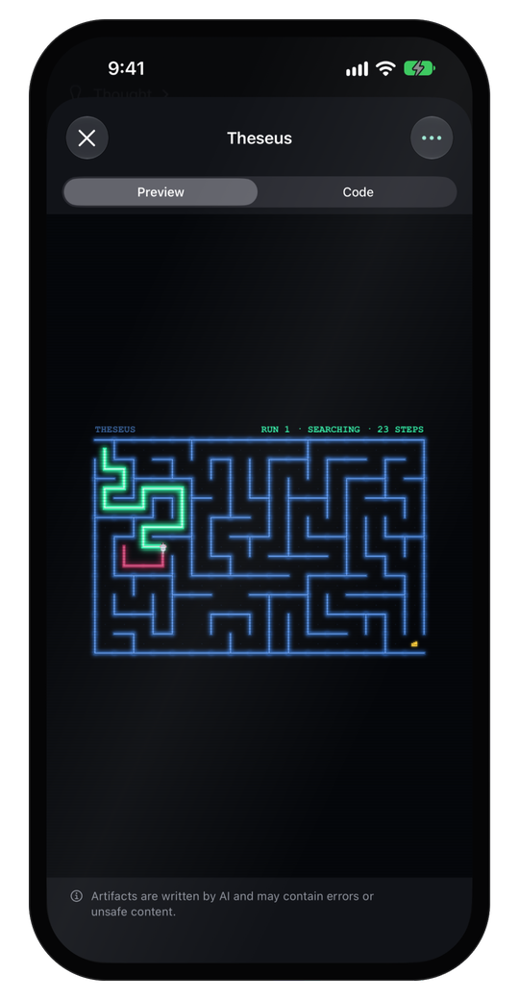<br><b>Artifacts</b><br>HTML, SVG and diagrams in a sandboxed viewer, with the code a tap away.</td>
<td align="center" valign="top">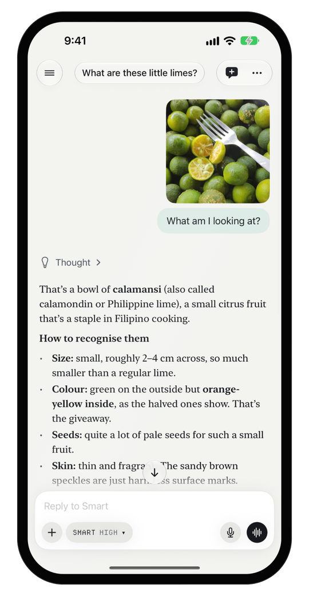<br><b>Photos and files</b><br>Attach photos, camera shots and files; models that can see read the images.</td>
</tr>
</table>

Artifacts open in a viewer that works offline, with a live preview and the code. If your server has a sandbox (Open
Terminal or a Jupyter code interpreter), models can run Python there; the charts and files they make show up in the
chat and can be opened or shared.

### Projects, Memory and history

<table>
<tr>
<td align="center" valign="top">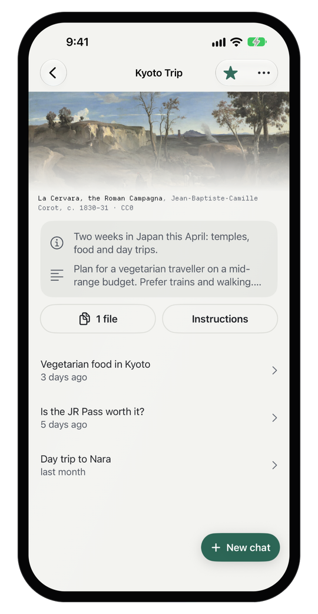<br><b>Projects</b><br>Instructions, knowledge files and the chats that belong together.</td>
<td align="center" valign="top">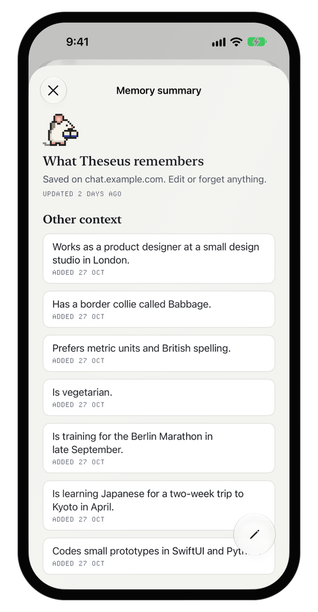<br><b>Memory you can read</b><br>See what it remembers about you. Edit or forget any of it.</td>
<td align="center" valign="top">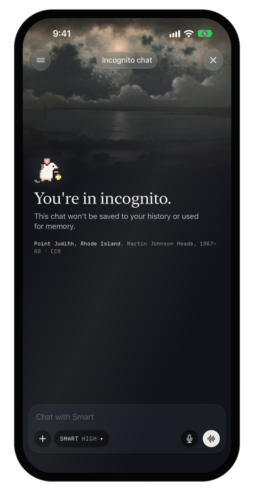<br><b>Incognito</b><br>Incognito chats aren't saved to your history or used for memory.</td>
</tr>
</table>

The drawer holds all your chats with search, stars and recents. Custom instructions and styles apply to every chat.

### iPad and iOS

<table>
<tr>
<td align="center" valign="top">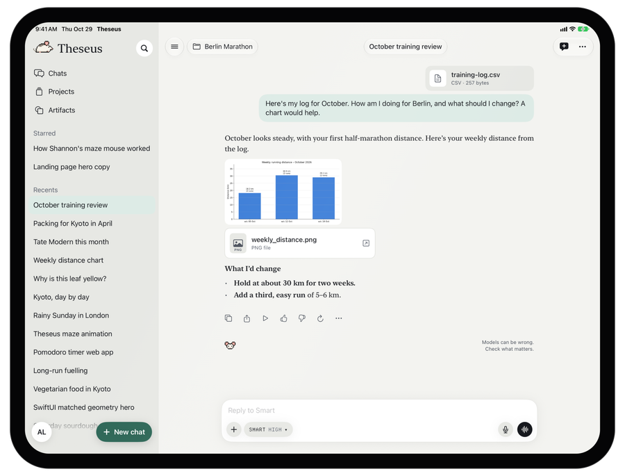<br><b>Made for iPad</b><br>A sidebar for your chats, split view and keyboard shortcuts.</td>
<td align="center" valign="top">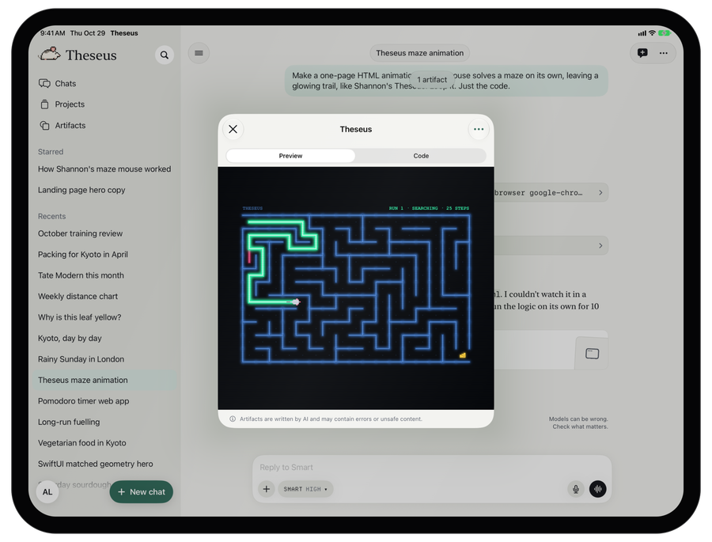<br><b>Room to work</b><br>Artifacts open over the chat, with your sidebar beside them.</td>
</tr>
<tr>
<td align="center" valign="top">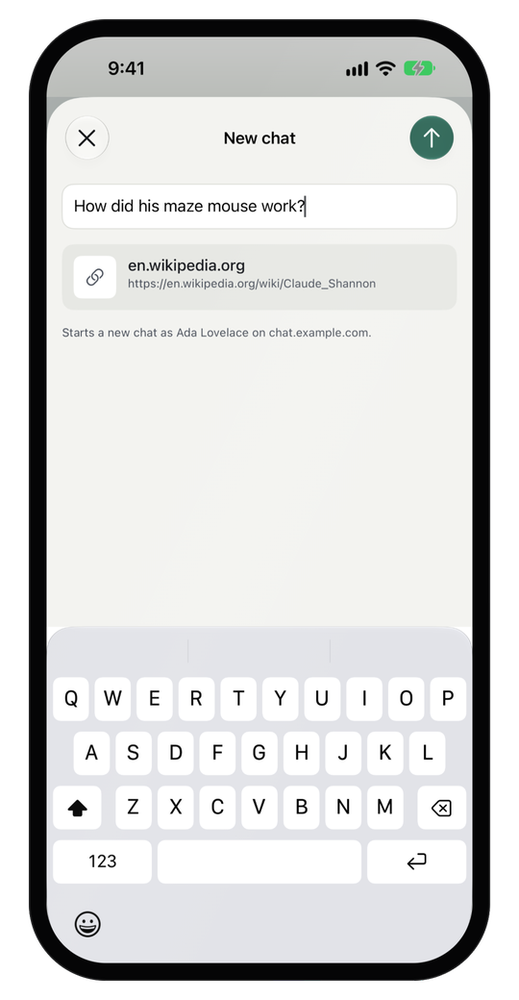<br><b>Share into Theseus</b><br>Links, text, photos and files from any app start a new chat.</td>
<td align="center" valign="top">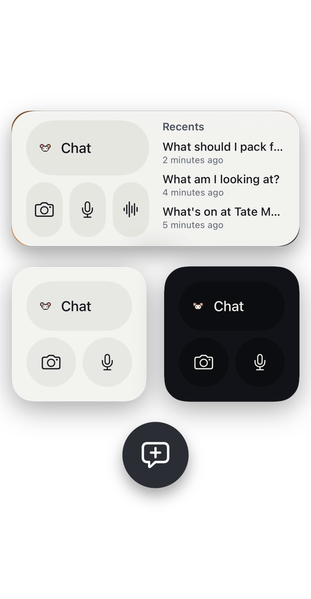<br><b>Widgets</b><br>Chat, camera, dictation and recent chats on the Home Screen; a new chat from the Lock Screen.</td>
</tr>
</table>

There are also Shortcuts and Siri actions and `theseus://` deep links. Light and dark mode, Dynamic Type and
VoiceOver are supported.

### Accounts

Several servers and accounts side by side; sign in with a password, LDAP or SSO, with two-step verification.

## Privacy

Theseus has no servers of its own and collects nothing. Your chats go only to the server you connect to.

Requires an Open WebUI server (0.12 or newer) and an account on it. Theseus is independent and not affiliated with the Open WebUI project.

## Building

Xcode 27.1 or newer (Swift 6.4), deployment target iOS 26.

```sh
scripts/bootstrap.sh      # installs XcodeGen if needed, resolves packages, generates Theseus.xcodeproj
open Theseus.xcodeproj
scripts/test.sh           # package tests + app tests on a simulator (--skip-app: packages only)
```

To run it on a device, choose your own team and change the bundle identifiers and the App Group in `project.yml`.

| Path | What |
|---|---|
| `project.yml` | XcodeGen spec. `Theseus.xcodeproj` is generated; never edit it by hand. |
| `App/` | The thin app shell, its tests and UI tests. |
| `Extensions/` | The widgets and the Share extension. |
| `Modules/` | A Swift package with the real code: `OpenWebUIKit` (API, Socket.IO), `ChatDomain`, `Persistence` (GRDB cache), `Auth`, `Rendering`, and one target per feature area. |
| `Modules/Tests/Fixtures/` | Scrubbed, recorded Open WebUI responses that the unit tests replay. |
| `scripts/` | Bootstrap, tests, fixture recorders, a stub server for sign-in flows, brand and licence generators. |

## Licence

GPL-3.0 with an additional permission for Apple's App Store and TestFlight: see [`LICENSE`](LICENSE) and [`NOTICE`](NOTICE.md).
